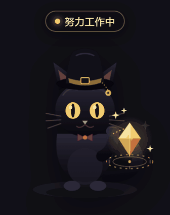

# 克莱恩猫 · DSH 桌面宠物

一只住在 DSH 网页界面右下角的黑色小猫：小礼帽、黄水晶、甜冰茶。三种工作状态可点击切换，每态有独立动效与音效。

> 需要先安装 **DSH 桌面客户端（DeepSeek Harness）**。本项目是它的界面插件，不是独立程序，脱离 DSH 无法单独运行。



<sub>动图由 `tools/gif/` 从同一份 `lib/client.js` 逐帧渲染生成（非录屏）：336×425（实机 168×220 画面宽度的 2 倍）、20fps、三态各 0.9 秒一轮。静态图见 [docs/preview.png](https://github.com/BeyondGu/klein-cat-pet/raw/main/docs/preview.png)。</sub>

> 粉丝向二创：礼帽、黄水晶、灰雾、甜冰茶等元素均为本项目手绘 SVG，不使用官方立绘。个人使用可以，公开发布/上架前请自行评估 IP 风险。

## 三种状态

| 状态 | 画面 | 动效 | 音效 |
| --- | --- | --- | --- |
| 努力工作中 | 端坐，抬爪用黄水晶占卜，脚下暗金法阵 | 水晶呼吸发光、法阵旋转、金色微粒环绕、尾巴慢摆、周期眨眼 | 黄水晶占卜铃音（清亮泛音 + 微光颗粒感） |
| 累了 | 趴下打瞌睡，耳朵下垂 | 呼吸起伏、`Zzz` 上浮、尾巴无力慢晃 | 两轮打呼噜（吸气 + 低频震颤） |
| 休息中 | 靠在软垫上，抱一杯甜冰茶 | 吸管气泡、吸吮小动作、冰块晃动、尾巴尖轻弹 | 吸管吸吮 + 气泡 + 冰块轻碰 |

点击猫本体：`努力工作中 → 累了 → 休息中 → 努力工作中` 循环，同时播放该状态音效。

## 操作

- **单击猫**：切换状态。
- **拖动猫**：移动到任意位置，位置会记住。
- **悬停猫**：右上角出现小工具栏——静音 / 复位位置 / 隐藏。
- **侧边栏底部猫爪按钮**：显示或隐藏宠物；隐藏后用它恢复。
- **键盘**：Tab 聚焦到猫后，Enter / 空格切换状态。
- 页面刷新、同源标签页切换时状态会保留；系统开启「减少动态效果」时自动关闭循环动画。

## 安装

本项目是标准的 DSH 客户端插件包：不需要 `npm install`，也没有构建步骤，下载下来就能用。

### 方式一 · 下载 Release 包（不需要 Git）

1. 打开 [最新 Release](https://github.com/BeyondGu/klein-cat-pet/releases/latest)，下载 `dsh-klein-cat-pet-X.Y.Z.zip`。
2. 解压，得到一个 `dsh-klein-cat-pet` 文件夹（里面是 `lib/`、`package.json`、`cordis.patch.yml` 等）。
3. 把**整个文件夹**放到 profile 的 `node_modules` 下：

```text
%USERPROFILE%\.dsh\profiles\<profile>\node_modules\dsh-klein-cat-pet
```

4. 重启 DSH 客户端（或刷新页面 `Ctrl+R`）。

> `<profile>` 是你在 DSH 里用的那个 profile 目录名；打开 `%USERPROFILE%\.dsh\profiles\` 就能看到有哪些。

### 方式二 · git clone + 插件命令

```powershell
git clone https://github.com/BeyondGu/klein-cat-pet.git
& "<DSH 安装目录>\resources\runtime\cli\bin\dsh.cmd" plugin --profile <profile> add "<克隆下来的仓库目录>"
```

两种方式效果相同，任选一条。装好后：界面右下角出现猫，侧边栏底部出现一个猫爪按钮；宿主侧只插入一个空实现的 loader 行，宠物全部在浏览器端渲染。

> `desktop` profile 由 DSH 桌面应用独占管理，`dsh plugin --profile desktop ...` 会被拒绝；桌面端请在应用内的 **设置 → 插件** 里安装/卸载。上面的 CLI 只适用于非 desktop 的 profile。

## 卸载

在 DSH 的 **设置 → 插件** 里移除 `dsh-klein-cat-pet`（或禁用）。卸载后猫、侧边栏猫爪和注入的样式都会消失。

非 desktop profile 也可以用：

```powershell
& "<DSH 安装目录>\resources\runtime\cli\bin\dsh.cmd" plugin --profile <profile> remove dsh-klein-cat-pet
```

## 目录

```text
klein-cat-pet/
├─ package.json           # dsh.client / dsh.bundle / exports / files
├─ cordis.patch.yml       # 插入 loader 行 id=klein-cat-pet
├─ lib/
│  ├─ index.js            # 宿主半：空 apply，保证 loader 行可加载
│  └─ client.js           # 浏览器半：React + 内联 SVG + CSS 动画 + Web Audio
├─ tests/smoke.mjs        # 清单、补丁、状态机、apply 接线冒烟
├─ tools/preview.mjs      # 从 client.js 提取同一份画面，生成静态预览页
├─ tools/gif/             # 逐帧渲染三态动图的脚本（Python + Chrome headless）
├─ docs/preview.png       # 三态静态预览截图
├─ docs/preview.gif       # 三态动效预览（README 首图）
├─ .github/workflows/
│  ├─ ci.yml              # push / PR 跑语法检查 + 冒烟 + 预览页
│  └─ release.yml         # 打 v* tag 自动出 Release 与分发 zip
├─ CHANGELOG.md           # 版本变更记录（Keep a Changelog）
└─ LICENSE                # MIT（仅覆盖代码）
```

## 开发

任意 Node ≥ 22 即可，无需 `npm install`：

```powershell
npm run check     # node --check lib/client.js，语法检查
npm test          # node tests/smoke.mjs，冒烟测试
npm run preview   # 生成 tools/preview.html，浏览器打开看三态
npm run verify    # 提交前跑这一条（check + test）
```

`tools/preview.mjs` 会生成 `tools/preview.html`（已列入 `.gitignore`）；`docs/preview.png` 就是用它截图的。

### 重新生成动图

`docs/preview.gif` 不是录屏：脚本把每条 CSS 动画冻结在指定的 `currentTime` 上逐帧截图再合成，
所以画面可精确复现、不会掉帧或启动抖动。

```powershell
node tools/gif/dump-art.mjs lib/client.js art.json
python tools/gif/make_gif.py art.json docs/preview.gif
```

需要 Python 3 + `pip install pillow`，以及 Chrome（非默认路径用环境变量 `CHROME_PATH` 指定）。
改了 `lib/client.js` 里的 SVG 或 CSS 之后重跑这两条即可。

几个与实机对齐的取景约定：画面按实机 `.kc-pet`（168×219）固定裁框、外扩 12px 让法阵和阴影露出来，
输出 2 倍宽 336px；帧率 20fps（50ms 正好整除 GIF 的 10ms 延时单位）；96 色调色板且不开抖动
（开 Floyd–Steinberg 抖动体积会翻一倍多）。两处已知的失真：GIF 只有 1 位透明，软过渡的辉光放上去会碎，
所以画面用深色面板底而不是透明底；另外每个状态只截前 0.9 秒，像眨眼（周期 6.4s）、法阵旋转（16/20s）
这类长周期动画在动图里只走了开头一小段，实机上比动图更"活"。

## 版本与发布

- 版本号遵循 SemVer：`0.1.1` 修 bug，`0.2.0` 加功能，`1.0.0` 槽位契约稳定。
- 发布流程：更新 `CHANGELOG.md` → 改 `package.json` 的 `version` → `git tag vX.Y.Z` 并推送 → `release.yml` 自动生成 Release 和 `dsh-klein-cat-pet-X.Y.Z.zip`。
- 分发包内容由 `package.json` 的 `files` 白名单控制，测试与预览产物不会被打进包里。
- 若将来要发布到 npm，直接 `npm publish` 即可（`files` 已配好）；不打算发布则把 `package.json` 里 `private` 设为 `true` 以防误发。

## 实现要点

- 挂载点：`shell.overlay`（list/root 浮层槽位，整层 click-through，本插件根节点自己接收点击）；侧边栏入口用 `sidebar.footer.action`。
- 生命周期：`ctx.effect` 注册/清理样式、store、两个槽位；HMR 或禁用插件时自动撤除，不会重复挂载。
- 音效：Web Audio 实时合成，无音频文件、无网络请求；首次点击时才创建 `AudioContext`（满足浏览器手势策略），之后静音只调增益。
- 持久化：`localStorage["klein-cat-pet:v1"]` 保存 `{state,xPct,yPct,muted,visible}`；位置用百分比，窗口缩放后仍可点。
- 降级：`AudioContext` 不可用则静默；`localStorage` 不可用则内存态；槽位不存在时只是不显示，不影响宿主。

## 扩展点

新增一种状态基本是加法，四张表在 `lib/client.js` 里已经是数据驱动的：

| 位置 | 作用 |
| --- | --- |
| `STATES` | 状态顺序，决定点击循环的次序 |
| `ART[state]` | 该状态的整段内联 SVG |
| `LABELS[state]` / `HINTS[state]` | 悬浮标签与提示文案 |
| `playWork` / `playTired` / `playRest` | 三态各自的 Web Audio 合成音效，由 `play(state, isMuted)` 调度 |

`__test` 暴露了 `STATES / LABELS / ART / normalize / nextState / layout / clamp01` 等接口，冒烟测试依赖它们——改动时保持可用，CI 就不会红。

## 已知限制

1. 音效是代码合成，不是真实录音；想换成 ASMR 级录音，把 3 个 wav/mp3 给我即可内嵌。
2. 状态是手动点击，不联动「AI 是否正在生成」；需要自动状态可以加 v2。
3. 这是 DSH 界面内的宠物，不是盖在其他软件上的系统桌面悬浮窗。
4. 位置/静音存在 `localStorage`；如果桌面端每次启动换端口（换 origin），这些偏好会重置。要跨重启保留，需要给宿主半加本地设置文件（v2）。
5. 兼容 DSH `0.2.2-rc.1` 的客户端槽位契约；升级 DSH 后若槽位变化需要回归。

## 声明

- 本项目是非官方的个人二创作品，与《诡秘之主》及其权利人无隶属关系，也未获其授权。
- 仓库内所有画面由代码手绘 SVG、音效由 Web Audio 实时合成，不包含任何官方美术或音频素材。
- 代码以 MIT 许可开放；角色相关元素不因代码许可而获得授权，若权利人提出异议将立即下架。
